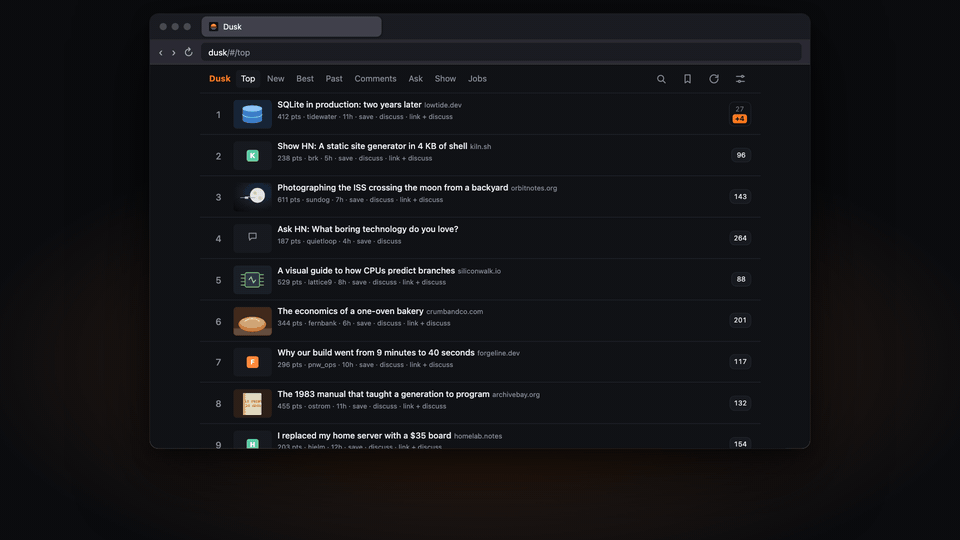
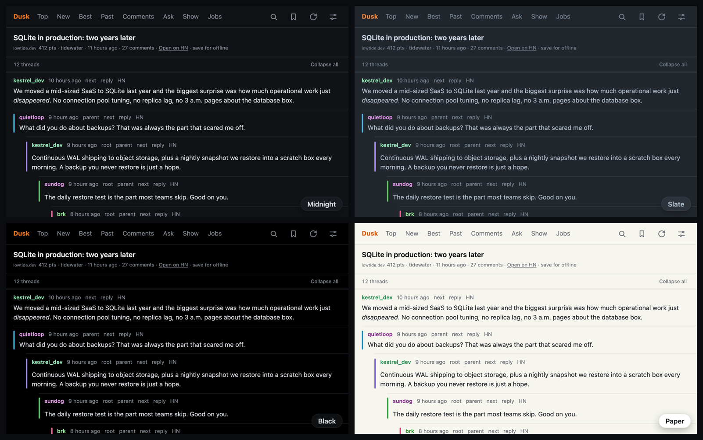
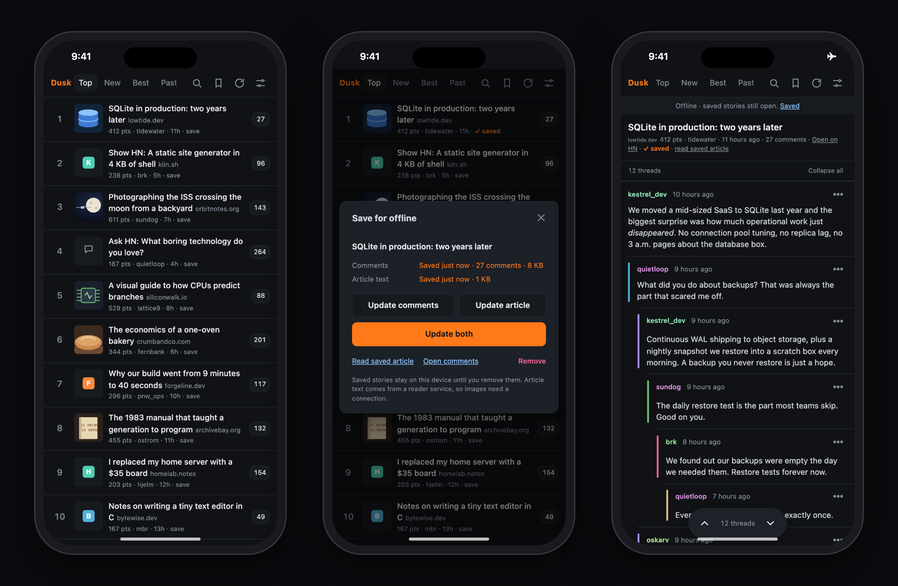

# Dusk

A fast, dark-first Hacker News reader for laptops and phones. It's a static web app with no backend and no account: open it in a browser, or install it to your Home Screen.

<p align="center"></p>

## Highlights

- **Fast.** The first screen needs under 30 kB of JavaScript, and the lists and threads you read last open instantly, even after a restart.
- **Colored threads.** Every reply level has its own color, and so does every author. Collapse any comment, jump between top-level comments with `n` and `p`, or switch comments to nested cards.
- **What's new.** The list shows how many comments arrived since your last visit, and the thread highlights them; `N` jumps from one to the next.
- **Made for phones.** Pick swipe actions for stories and comments; installed to the Home Screen, Dusk also swipes back and forward and pulls to refresh. The list never reshuffles under your thumb: it re-ranks only when you refresh.
- **Offline.** Save a story's comments, its article text or both, and read them without a connection. On iPhone, install Dusk so iOS keeps them.
- **Make it yours.** Five themes plus automatic light and dark, comment bar palettes, fonts, text size, and split view on wide screens, all previewed live in Settings. Press `?` for keyboard shortcuts.
- **All of HN.** Top, New, Best, Ask, Show, Jobs, past front pages, the newest comments, search and profiles. Voting, replying and submitting open HN itself.





## Development

Needs Node 22 and pnpm (versions pinned in `.node-version` and `package.json`).

```bash
pnpm install
pnpm dev                  # dev server on http://localhost:5173 (add --host to open it from a phone)
pnpm test                 # unit tests (vitest)
pnpm lint                 # oxlint, type-aware
pnpm build && pnpm size   # production build, then the 30 kB first-paint budget
pnpm preview              # serve the production build
```

Pushing to `master` lints, tests, builds and deploys to GitHub Pages. [AGENTS.md](AGENTS.md) explains how the code is organized and the rules changes follow.
